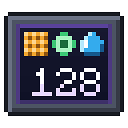

# AE2 Pattern Counter



Monitor parts for **Applied Energistics 2** that show how many patterns of one type your ME network knows.
Place one on a cable and read the count on its screen.

## Supported versions

| Minecraft | Loader | Applied Energistics 2 | Counters | Branch |
|---|---|---|---|---|
| **1.21.1** | **NeoForge** | **19.2+** | **all 5** | **`1.21.1` (this branch)** |
| 1.20.1 | Forge, Fabric | 15.x | all 5 | [`1.20.1`](https://github.com/Madgique/ae2_pattern_counter/tree/1.20.1) |
| 1.12.2 | Forge / Cleanroom | AE2 Unofficial Extended Life | Crafting, Processing, Fluid | [`1.12.2`](https://github.com/Madgique/ae2_pattern_counter/tree/1.12.2) |

## Counters

| Counter | Counts | Center item of the recipe |
|---|---|---|
| Crafting Pattern Counter | Crafting table patterns | Crafting Table |
| Processing Pattern Counter | Processing (machine) patterns | Furnace |
| Smithing Pattern Counter | Smithing table patterns | Smithing Table |
| Stonecutting Pattern Counter | Stonecutter patterns | Stonecutter |
| Fluid Pattern Counter | Patterns with a fluid input or output | Water Bucket |

## How to use

1. Craft a counter. All recipes use the same shape:

   ```
   Quartz Glass   Storage Monitor   Quartz Glass
   Blank Pattern  <center item>     Blank Pattern
   Quartz Glass   Blank Pattern     Quartz Glass
   ```

2. Place the counter on an ME cable, like any AE2 part.
3. Read the screen. The count updates within 5 seconds after a change.

| Screen | Meaning |
|---|---|
| Icon and number | The part works. |
| Red blinking `OFFLINE` | The part has power but no channel. |
| Dark screen | The network has no power. |

Use a wrench to turn the screen when the part is on a floor or a ceiling.

## Requirements (1.21.1)

- NeoForge 21.1.169+
- Applied Energistics 2 19.2+ (it brings its own GuideME dependency)

## Building

Use JDK 21 or newer.

```bash
./gradlew build
```

The jar is in `build/libs/`. To test in game, use `./gradlew runClient` (or `runServer`).

## Releasing

1. Set `mod_version` in `gradle.properties`.
2. Replace the content of `CHANGELOG.md` with the notes of this version only.
3. Push a tag `v<version>-1.21.1`:

   ```bash
   git tag v1.2.0-1.21.1 && git push origin v1.2.0-1.21.1
   ```

The **Publish** workflow builds the mod and uploads the jar to Modrinth and CurseForge.
It needs these repository secrets: `MODRINTH_TOKEN`, `MODRINTH_PROJECT_ID`, `CURSEFORGE_TOKEN`, `CURSEFORGE_PROJECT_ID`.

## License

LGPLv2.1. Created by Madgique.
